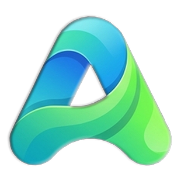

<div align="center">



# 🖐️ افزونه آبنر | Abner Extension

### صفحه تب جدید مدرن فارسی — همه‌ی ابزارهای روزمره در یک نگاه

🇮🇷 **فارسی** | 🇺🇸 [English](./README.en.md)

[](https://github.com/MortezaAbner/ChromeExtensions)
[](https://github.com/MortezaAbner/ChromeExtensions/releases)
[](LICENSE)
[](https://MortezaAbner.github.io/ChromeExtensions)

[](https://github.com/MortezaAbner)
[](https://github.com/MortezaAbner)
[](https://github.com/MortezaAbner/ChromeExtensions/pulls)

</div>

---

## ✨ ویژگی‌های آبنر

<table>
<tr>
<td width="50%">

### 🗓 تقویم شمسی
- تقویم کامل جلالی، قمری و میلادی
- ۹۰+ مناسبت ایرانی، اسلامی و بین‌المللی
- نمایش تعطیلات رسمی با رنگ قرمز
- مبدل تاریخ با بازه نامحدود
- نمای ماهانه شیشه‌ای

### ⏰ ساعت و تاریخ
- ساعت زنده به فارسی
- تاریخ شمسی، میلادی و قمری
- نمایش روز هفته
- اوقات شرعی با قوس زنده خورشید و ماه

### 🌦 آب‌وهوا
- پیش‌بینی ۶ روزه
- حالت‌های مختلف (آفتابی، بارانی، برفی، رعد و برق)
- تشخیص موقعیت با GPS و IP
- جستجوی ۴۷ شهر پرکاربرد ایران و جهان

</td>
<td width="50%">

### ✅ تسک و یادداشت
- مدیریت تسک‌ها با اولویت و برچسب
- یادداشت‌های سریع
- همگام‌سازی با Google Tasks
- ذخیره‌سازی خودکار

### 🔗 بوکمارک
- پوشه‌بندی هوشمند
- ۶ پوشه قابل تنظیم
- دکمه دسترسی سریع «افزونه آبنر»
- آیکون‌های خودکار سایت‌ها

### ⏱ تایمر
- تایمر با تنظیم تایپ و اسکرول ماوس
- ذخیره‌سازی خودکار
- هشدار صوتی در پایان
- ادامه پس از بستن مرورگر

### 🔍 جستجوی هوشمند
- پشتیبانی از ۱۳ موتور جستجو
- موتورهای ایرانی: ذره‌بین، گردو، پارس‌است
- جستجوی صوتی و تصویری
- دراپ‌دان شیشه‌ای

</td>
</tr>
</table>

---

## 👨‍💻 درباره پروژه

<div align="center">

> *«آبنر از یک ایده‌ی ساده شروع شد: چرا صفحه‌ی تب جدید نباید مثل یک میز کار مرتب و زیبا باشه؟»*

</div>

آبنر یک پروژه‌ی **open-source شخصی** است که با ترکیب طراحی مدرن، معماری ماژولار و استفاده از ابزارهای نوین توسعه، برای کاربران فارسی‌زبان ساخته شده است.

### 🎯 فلسفه‌ی پروژه

- **🇮🇷 بومی‌سازی کامل** — تقویم شمسی، اوقات شرعی، موتورهای جستجوی ایرانی
- **🎨 طراحی مدرن** — Glassmorphism با قابلیت تنظیم کامل ماتی و شفافیت
- **🔐 حریم خصوصی اول** — داده‌ها در حساب گوگل خود کاربر ذخیره می‌شه
- **📱 چند‌سکویی** — افزونه کروم + وب‌اپ PWA روی همه دستگاه‌ها
- **🆓 کاملاً رایگان** — بدون تبلیغ، بدون اشتراک

### 🛠 روش توسعه

این پروژه با **ایده‌پردازی و طراحی شخصی** شروع شد و در مسیر ساخت، از **ابزارهای نوین توسعه (از جمله هوش مصنوعی)** به‌عنوان دستیار فنی استفاده شده است. هر قابلیت پس از طراحی، آزمون و بازبینی نهایی در محصول قرار گرفته.

> 💡 *مثل معماری که برای ساختن یک بنای زیبا از AutoCAD استفاده می‌کند — ابزار، جای خلاقیت و ایده را نمی‌گیرد.*

### 🎁 هدف نهایی

ساخت یک **ابزار کاربردی، زیبا و رایگان** برای همه‌ی فارسی‌زبانان در سراسر جهان که در دنیای پرهیاهوی اینترنت، وقت و تمرکزشون رو هدر نده.

---

## 🎨 تم‌های قابل تغییر

<table>
<tr>
<td align="center">✨<br /><b>شیشه‌ای</b><br />Aurora Glass</td>
<td align="center">🌙<br /><b>تاریک</b><br />Dark</td>
<td align="center">☀️<br /><b>روشن</b><br />Light</td>
</tr>
</table>

- 🎚️ **تنظیم ماتی و شفافیت** برای همه المان‌ها
- 🎨 **پس‌زمینه شفق قطبی** در حالت شیشه‌ای
- 🔄 **تغییر سریع** با تک کلیک روی آیکون تم

---

## 🔐 ورود و همگام‌سازی

<div align="center">

| حالت | ذخیره‌سازی | همگام‌سازی |
|:---:|:---:|:---:|
| 🚪 **بدون لاگین** | لوکال | ❌ |
| 🔑 **با گوگل** | لوکال + Drive | ✅ |

</div>

- ✅ **ورود امن با OAuth 2.0 گوگل**
- ✅ **ذخیره‌سازی داده‌ها در Google Drive AppData** (پوشه امن خصوصی)
- ✅ **بدون سرور واسطه — کاملاً امن**
- ✅ **کارکرد کامل در حالت آفلاین**
- ✅ **همگام‌سازی خودکار بین همه دستگاه‌ها**

---

## 🚀 نصب و راه‌اندازی

### نصب از Chrome Web Store
```
🔜 به‌زودی
```

### نصب دستی (Developer Mode)

```bash
# ۱. دانلود آخرین نسخه
git clone https://github.com/MortezaAbner/ChromeExtensions.git
```

سپس در Chrome:
```
۱. برو به chrome://extensions
۲. Developer Mode را روشن کن (بالا راست)
۳. Load unpacked بزن
۴. پوشه پروژه رو انتخاب کن
```

### نصب وب‌اپ (PWA)
```
۱. آدرس https://MortezaAbner.github.io/ChromeExtensions رو باز کن
۲. از منوی مرورگر → Add to Home Screen
```

---

## 🛠 تکنولوژی‌ها

<div align="center">


</div>

- 🧩 **معماری ماژولار** — هر قابلیت یک ماژول مستقل
- 🎨 **Glassmorphism** — طراحی شیشه‌ای مدرن
- 🔌 **APIهای استفاده‌شده:**
  - Open-Meteo (آب‌وهوا)
  - Nominatim (جستجوی شهر)
  - Aladhan (اوقات شرعی)
  - Google Drive / Tasks / Calendar

---

## 📊 ساختار پروژه

```
ChromeExtensions/
├── 📄 manifest.json
├── 📄 index.html
├── 📄 style.css
├── 📄 app.js
└── 📁 modules/
    ├── 🎨 glass/         # موتور شیشه‌ای
    ├── ⏰ clock/         # ساعت و تاریخ
    ├── 📅 calendar/      # تقویم شمسی + مبدل
    ├── 🌦 weather/       # آب‌وهوا
    ├── 🕌 prayer/        # اوقات شرعی
    ├── ⏱ timer/         # تایمر
    ├── ✅ tasks/         # تسک و یادداشت
    ├── 🔗 bookmarks/     # بوکمارک
    ├── 🔍 search/        # نوار جستجو
    ├── 🎛 dock/          # داکر پایین
    ├── 🔑 auth/          # احراز هویت گوگل
    └── ☁️ sync/          # همگام‌سازی
```

---

## 🤝 مشارکت

از هر نوع مشارکتی استقبال می‌کنیم!

- 🐛 **باگ پیدا کردی؟** [Issue بساز](https://github.com/MortezaAbner/ChromeExtensions/issues)
- 💡 **ایده داری؟** [Discussion باز کن](https://github.com/MortezaAbner/ChromeExtensions/discussions)
- 🔧 **می‌خوای کد بزنی؟** Pull Request بفرست

---

## 📜 لایسنس

<div align="center">

[](LICENSE)

</div>

این پروژه تحت لایسنس **PolyForm Noncommercial 1.0.0** منتشر شده است.

### 🇮🇷 به زبان ساده

| استفاده | مجاز؟ |
|---|:---:|
| 🏠 استفاده شخصی | ✅ |
| 🎓 استفاده آموزشی | ✅ |
| 🔬 تحقیق و پژوهش | ✅ |
| 🎨 پروژه‌های سرگرمی | ✅ |
| 🏢 سازمان‌های غیرتجاری | ✅ |
| ✏️ تغییر کد | ✅ |
| 📤 انتشار مجدد (با ذکر منبع) | ✅ |
| 💰 **فروش کد** | ❌ |
| 💼 **استفاده در محصول تجاری** | ❌ |

### 🇺🇸 Summary (English)

This project is licensed under the **PolyForm Noncommercial License 1.0.0**.

- ✅ Free for personal, educational, research, and non-commercial use
- ✅ You may modify and redistribute with attribution
- ❌ **Commercial use and selling are strictly prohibited**

> ⚠️ **توجه:** این یک لایسنس Open Source استاندارد (OSI) نیست. استفاده تجاری نیاز به مجوز جداگانه از توسعه‌دهنده دارد.

### 📧 برای استفاده‌ی تجاری

اگه می‌خوای از این پروژه در محصول تجاری استفاده کنی، لطفاً از طریق [GitHub](https://github.com/MortezaAbner) تماس بگیر.

---

<div align="center">

### ⭐ اگه آبنر رو دوست داری، بهش ستاره بده!

ساخته‌شده با ❤️ توسط [Morteza Abner](https://github.com/MortezaAbner)

[](https://github.com/MortezaAbner)
[](https://github.com/MortezaAbner/ChromeExtensions)

</div>
